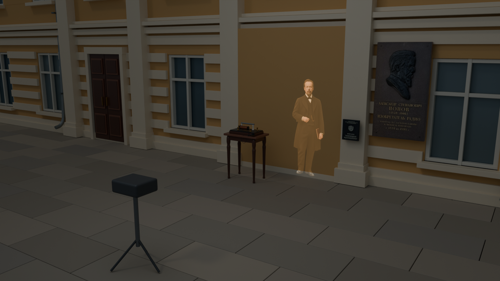

# Проектор Попова

Текущий запуск на Windows и локальный HTTPS описаны в [LOCAL-WIFI.md](LOCAL-WIFI.md).
Локальные ключи сертификатов хранятся в исключённой из Git папке `work/lan-tls`.

Текущее локальное обновление: [дизайн, голос «Денис», проекция и cookie-сессии](ОБНОВЛЕНИЕ-ДИЗАЙНА.txt).
QR обновляется раз в две минуты и действует только для входа. После входа
пользователь получает три вопроса без таймера; сессия привязана к случайной
HttpOnly-cookie и User-Agent браузера. Проекция содержит только аватара
с прозрачными PNG-позами и QR в правом нижнем углу. Настройки тестирования — F2.

Русскоязычный музейный аватар Александра Попова для Mac и проектора. Ноутбук озвучивает входящий текст и отрисовывает губы по фонемам и громкости, акценты бровями и небольшие движения головы. Для художественной озвучки выбран мужской русский голос «Денис» из Piper. Модель читает новые фразы целиком на ноутбуке. Пульт и оба ролика используют один голос. Для автономной экскурсии достаточно дисплея и звукового выхода. QR-станция использует DeepSeek для ответов и настраиваемую серверную озвучку.

[Демонстрация с общим и крупным планами](Ответ%20про%20приёмник.mp4) · [Приветствие крупным планом](Проверка%20мимики.mp4) · [Установка в Blender](Модели/Установка%20проектора.blend) · [Инструкция для площадки](Как%20запустить%20проекцию.md)



## Запуск на Mac

Проверено на Apple Silicon с macOS, Python 3.12 и установленными инструментами командной строки Xcode. Для опубликованных колёс зависимостей на Apple Silicon требуется macOS 14 или новее.

```sh
git clone https://github.com/kiriltorop-ux/popov-projector.git
cd popov-projector
./setup.command
open "Пульт Попова.app" --args --offline
```

Установщик автономного режима создаёт локальную `.venv`, загружает закреплённые зависимости, проверяет синтез и собирает исполняемое приложение из Swift. При нестандартной установке Python передайте путь через `POPOV_PYTHON`. При первой установке скачиваются веса русского голоса (63 МБ) и его конфигурация. Для распознавания русской речи устанавливается Whisper base Q5 (60 МБ). Установщик сверяет SHA-256 файлов моделей.

## QR-станция с мобильным приложением

### Кузьма Минин

Для показа Минина создайте локальный `.env`, если его ещё нет, и добавьте
`POPOV_GUIDE=minin`. На Mac выполните
`./setup-local.command` и откройте «Пульт Попова.app». На Windows запустите
`start-windows.cmd`. Установщик проверит модель голоса «Дмитрий».

После сканирования QR откроется разговор с Мининым. «Расскажи свою историю»
запускает на проекторе русскоязычный ролик «История рядом» (около 70 секунд).
После показа возвращается живой аватар с ответами об ополчении. История и
вопросы используют общий лимит из трёх запросов. Неудавшийся или прерванный
показ освобождает зарезервированный запрос.

Если DeepSeek недоступен или `LLM_API_KEY` не задан, Минин отвечает по подготовленным темам о себе,
сборе ополчения, Пожарском и освобождении Москвы. С ключом DeepSeek доступны
ответы в свободной форме. Для голосового ввода со стороны посетителя
используется отдельный ключ `ASR_API_KEY`.

### Подключение станции

Станция раздаёт текущую Vue-сборку из `mobile/docs` и API с одного адреса. QR открывает чат выбранного персонажа. Телефон отправляет вопрос, получает текст и видит статус ответа. Пульт получает аудио и воспроизводит его на оборудовании площадки.

### macOS

```sh
./setup-local.command
```

Установщик собирает пульт и создаёт `.env` с локальными секретами. Укажите в `.env` ключ DeepSeek в `LLM_API_KEY`. Для распознавания аудиозаписей укажите также ключ Groq в `ASR_API_KEY`. Откройте «Пульт Попова.app». Он запустит сервер и покажет QR. Подключённый расширенный дисплей выбирается при запуске. Для выбора экрана вручную откройте приложение с параметром `--test-panel`.

### Windows

Установите Python 3.12 с Tcl/Tk и запустите `start-windows.cmd`. При первом запуске заполните те же поля в `.env` и запустите файл снова. Кнопка «Открыть чат» открывает текущую QR-ссылку, F11 переключает полноэкранный просмотр.

### На телефоне

1. Подключитесь к той же сети Wi-Fi и отсканируйте QR на экране Попова.
2. Нажмите «Начать разговор». Задайте вопрос на русском. Для аудиовопроса нажмите микрофон рядом с полем ввода, распознайте запись и проверьте текст перед отправкой.
3. Текст появится в чате, а голос прозвучит у проектора. За один QR-сеанс можно задать три вопроса. QR меняется каждые две минуты. Принятый ответ остаётся в чате и может прозвучать после окончания доступа.

Для микрофона в браузере нужен HTTPS, при подключении по локальному HTTP доступны текст и загрузка записи. Если компьютер выбирает адрес VPN, укажите IPv4 Wi-Fi в `POPOV_LAN_HOST`. При подключении с телефона порт TCP 18776 должен быть доступен в сети площадки. Для HTTPS задайте `POPOV_LOCAL_PUBLIC_URL` с адресом доверенного обратного прокси.

Для отдельного сервера используются `compose.yaml` и `.env.example`. Укажите домен, `PUBLIC_URL` и собственные случайные `QR_SECRET` и `STATION_KEY`. На Mac запустите `./setup-station.command`, затем заполните `station.env` адресом сервера и ключом станции. Храните оба файла настроек на компьютерах, которым они нужны.

## Как разговаривать

Точка и вопросительный знак задают окончание фразы. Можно указать подачу в начале короткой реплики, например `[спокойно] Подойдите поближе.` или `[с интересом] Слышите **звонок**?` Метка действует на один речевой фрагмент. Она меняет скорость и вариативность длительностей звуков и исключается из озвучки. Звёздочками выделяют смысловое ударение. Без метки пульт выбирает спокойную подачу, а для объяснений об опытах и приёмнике — чуть более оживлённую.

- **Начать экскурсию** запускает готовый рассказ «У радиоприёмника» из 170 речевых фрагментов. Текст лежит в папке **Примеры**.
- **Произнести** озвучивает текст из поля. Выделение `**слова**` усиливает смысловой акцент. В режиме **Вопрос посетителя** пульт выбирает подготовленный ответ по теме вопроса.
- **Перебить** отменяет текущий рассказ и очередь, затем сразу озвучивает текст из поля или отвечает на вопрос. **СТОП** гасит проекцию и звук до ручного возобновления.
- В настройках macOS выберите для проектора расширенный дисплей. В пульте выберите его имя и нажмите **Вывести**. До подключения доступно отдельное пробное окно.

## Вход для приложения

Локальный адаптер на ноутбуке может послать команду через закрытый Unix-сокет. Одна UTF-8 JSON-команда на соединение, строка завершается переводом строки. Утилита `control.py` использует стандартную библиотеку Python и показывает ответ в JSON.

```sh
python3 Исходники/control.py say --file "Примеры/У радиоприёмника.txt" --id tour-01
python3 Исходники/control.py event --id tour-01
python3 Исходники/control.py ask "Как работает приёмник?" --interrupt
python3 Исходники/control.py stop
python3 Исходники/control.py resume
```

`say` принимает до 32 000 знаков, `ask` — вопрос до 400 знаков. В очереди помещаются пять команд помимо активной. В рамках текущего запуска повтор идентификатора с тем же содержимым возвращает его прежний статус. Ограничение срока относится к началу воспроизведения. Уже звучащая экскурсия продолжается и после истечения этого срока. HTTP-вход посетителя поддерживает текст и короткие аудиозаписи.

## Как устроено воспроизведение

1. Сервис делит рассказ по предложениям, сохраняя выделение слов. Для быстрого старта первый фрагмент ограничен 88 знаками, последующие — 180. Синтез следующей порции идёт во время воспроизведения. В очереди аудиодвижка одновременно до трёх фрагментов.
2. Прогретая модель Piper возвращает моно PCM с частотой 22 050 Гц и длительности фонем для этой же звуковой дорожки. В памяти хранятся первые фразы типовых ответов, а также недавние результаты. Кэш ограничен 48 фрагментами и 12 МиБ PCM.
3. Между процессами передаются сырой PCM и разметка. Заголовок содержит две 32-битные длины в сетевом порядке, за ними — JSON и звуковые байты. AVAudioEngine запускается при открытии пульта. Один AVAudioPlayerNode последовательно выводит порции без повторного открытия аудиоустройства. На границах предложений сохранены короткие речевые паузы.
4. SpriteKit выбирает позу по позиции аудиоузла в отсчётах. Переходы губ и усиление артикуляции читаются по времени того же фрагмента. Счётчик `underruns` показывает случаи, когда к моменту постановки порции часы узла уже прошли конец предыдущей.

## Проверка на своей установке

```sh
# Пульт должен быть открыт, в очереди не должно быть других реплик.
python3 Исходники/latency.py
python3 Исходники/soak.py "Примеры/У радиоприёмника.txt"
```

Первый скрипт измеряет время от принятия 20 разных текстов до запуска первого буфера. Второй проигрывает экскурсию в реальном времени и проверяет длительность, завершение каждого фрагмента и счётчик опустошений. Встроенная метка задержки на пульте и на стене позволяет отдельно оценить задержку конкретного проектора.

### Задержка с голосом «Денис»

На Apple M2 Pro тестовый пульт воспроизвёл 20 разных реплик. От приёма текста до запуска первого аудиобуфера медиана составила 74 мс, 95-й процентиль — 137 мс, максимум — 157 мс. Модель была прогрета. Акустическая задержка и задержка проектора измеряются отдельно.

### Результаты на Apple M2 Pro до смены голоса

| Проверка | Результат |
| --- | --- |
| 20 разных реплик, медиана приёма текста до запуска первого буфера | 12 мс |
| Те же 20 реплик, 95-й процентиль / максимум | 22 / 26 мс |
| Повтор вопроса о приёмнике, 8 попыток, медиана | 6,5 мс |
| Экскурсия «У радиоприёмника», реальное время аудио | 10 мин 36,1 с |
| Подтверждения сыгранных фрагментов / опустошения буфера | 170 из 170 / 0 |

Пульт был прогрет, для замера использовался звуковой выход Mac с нулевой тестовой громкостью. На предыдущей версии медиана тех же 20 реплик составляла 28,5 мс. В проверке прерывания прежний рассказ и ожидающий текст получили статус `cancelled`, а ответ посетителю — `finished`. При проверке мимики на живых аудиочасах позиции росли последовательно во всех трёх фрагментах ответа. Акустическую задержку колонок и задержку изображения на стене нужно измерять на установленном оборудовании.

В каталоге **Исходники** находятся код пульта, сервис, озвучка, рендер демонстрации и экспорт поз. В **Модели** находятся самодостаточные сцены Blender для рига и установки. В **Ресурсы** — подготовленные текстуры поз для показа. Сведения об источниках сохранены в [атрибуции](CREDITS.md).


## Изменения этой версии

- Веб-интерфейс включён в `mobile/`; Git-подмодули не требуются.
- Между ответами аватара выдерживается пауза не менее секунды.
- Ответ начинается с краткого повторения сути вопроса.
- Посетитель видит своё место в очереди; текст ответа появляется после завершения озвучки.
- Кнопка микрофона записывает голос при удержании и отправляет вопрос после отпускания.
  Для микрофона на телефоне нужен HTTPS и разрешение браузера; настройка описана в `LOCAL-WIFI.md`.
- Исправлена загрузка голоса Piper в путях Windows с кириллицей.

API-ключи, локальная база, сертификаты и виртуальное окружение в репозиторий не включены.
Создайте локальную `.env` по инструкции запуска и укажите собственные ключи.

Исходные проекты: [popov-projector](https://github.com/antony502189-max/popov-projector)
и [gorod-govorit](https://github.com/antony502189-max/gorod-govorit).
Исходная атрибуция сохранена в `CREDITS.md` и материалах веб-интерфейса.
